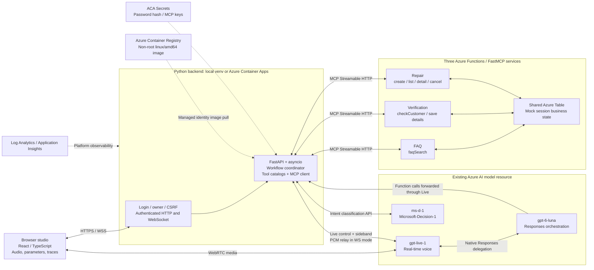
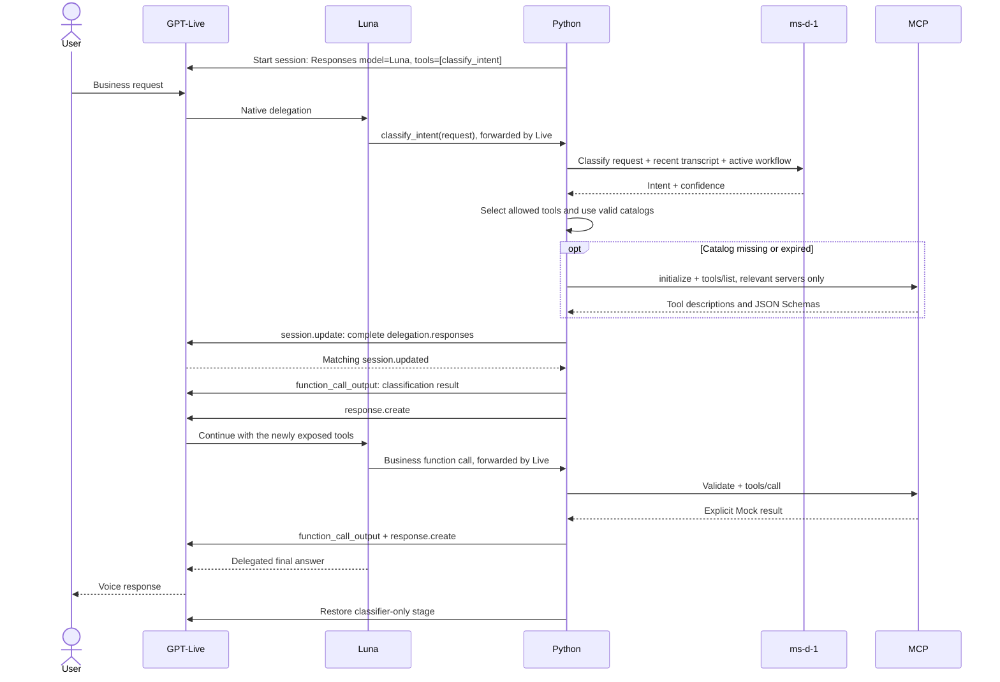

# GPT-Live Intent-Driven MCP

[English](README.md) | [简体中文](README.zh-CN.md)

**A Python voice-agent studio that connects native GPT-Live Responses delegation, Microsoft-Decision-1 intent routing, and dynamically exposed MCP tools on Azure.**

Talk to GPT-Live, let Luna orchestrate the request, classify it with Decision-1, and expose only the tools needed for that intent. Review the complete delegation, tool-discovery, configuration-update, and MCP execution timeline in the browser.

> **Demo boundary:** model inference, MCP transport, authentication, and Azure infrastructure are real. FAQ content, customer records, and repair orders are explicitly **Mock**. This project does not contact a real service center, send repair emails, verify phone ownership, or control appliances. Azure calls and hosted resources may incur charges.

## Why this project

| Highlight | Implementation and benefit |
| --- | --- |
| Native Responses delegation | GPT-Live delegates to `gpt-6-luna` through its session configuration; Python does not substitute a separate chat session or client-delegation workflow. |
| Intent-driven tool exposure | Luna starts with **one** tool, `classify_intent`. Python calls `ms-d-1`, then opens the permitted business functions for that request. |
| Confirmed hot updates | A complete `session.update` replaces `delegation.responses.tools`. Python waits for the matching update before returning the classification result and continuing Luna. |
| No business-MCP startup dependency | Starting a Live session performs **zero business-tool discovery calls**. Discovery is deferred to the first relevant request. |
| Lazy, cached, parallel catalogs | Tool definitions are cached per server for 300 seconds. Same-server refreshes are coalesced; independent servers are discovered concurrently. Expired refresh failures do not silently reuse stale catalogs. |
| Observable voice workflow | The UI shows effective tools, intent/confidence, queue state, parent-child spans, startup phases, and MCP timings. It does not fabricate hidden reasoning or user-heard latency. |
| Guarded execution | Intent allowlists, schema validation, application-injected `contactId`, required customer fields, call-ID deduplication, and classification versions protect execution. |
| Azure-hosted, login-gated studio | HTTPS/WSS, backend API/WebSocket authentication, password hashing, CSRF, logout/expiry, managed identity, and secret references are implemented. |
| Small, explicit orchestration layer | FastAPI, `asyncio`, and the official MCP SDK implement the workflow without adding an agent framework. The code paths remain directly inspectable. |

## Architecture



WebRTC media is negotiated directly between the browser and the Live service. In WebSocket mode, Python relays headerless 24 kHz mono PCM16 audio. MCP servers receive JSON arguments, **not audio**.

### Azure components

| Component | Responsibility |
| --- | --- |
| Existing Azure AI / Foundry resource | Hosts the three model deployments; a project URL is not the inference origin. |
| `gpt-live-1` | Speech interaction, transcription, and native delegation to the Responses backend. |
| `gpt-6-luna` | Calls the classifier, generates business-tool arguments, collects missing fields, and produces the delegated answer. |
| `ms-d-1` | Deployment name for Microsoft-Decision-1; returns one intent choice, confidence, and category probabilities. It is not a generative Responses model. |
| Azure Container Apps | Hosts the Python API and built React studio. Reference configuration: eastus2, one warm replica, 0.5 vCPU / 1 GiB, HTTPS-only ingress. |
| Azure Container Registry | Stores the non-root, venv-based `linux/amd64` application image. Image pulls use managed identity. |
| Three Azure Function Apps | Independently host the FAQ, Verification, and Repair Streamable HTTP MCP services. Reference runtime: Python 3.13, Flex Consumption, self-hosted MCP custom handler. |
| Azure Storage / Table | Shared Mock business state plus separate Functions runtime storage. The reference topology uses four Storage accounts. |
| VNet, private endpoints, private DNS | Functions reach private Blob/Table endpoints. The reference topology keeps Storage public access and shared-key authentication disabled. |
| User-assigned identities / Azure RBAC | Function identities access storage; the studio identity pulls images and calls the existing model resource. Roles are resource-scoped. |
| ACA Secrets | Supplies the login password hash and Function keys; no shared password or token is committed. |
| Application Insights / Log Analytics | Functions and hosting platform telemetry. UI spans are a separate, in-memory application event stream, not automatically a complete portal distributed trace. |

No separate Azure AI Search, standalone Speech resource, APIM, Redis, Cosmos DB, or hosted-agent service is required by the current implementation.

## Intent-driven delegation: the key workflow



**Luna does not browse an unrestricted MCP registry.** Python knows the configured servers and the intent-to-tool allowlist. Luna sees only the currently declared function names, descriptions, and schemas. “Hot loading” changes model-visible definitions and execution permission, not model code or Function deployments.

Tool updates are **Live-session scoped**. Business delegations in one session are coordinated serially; voice/event reception continues. Different Live sessions are independent. Premature or unauthorized business actions are rejected rather than replayed later using stale permissions.

An update acknowledgement is not a guarantee that all asynchronous backend configuration validation has finished. Later configuration errors still stop business execution. Low-confidence requests use clarification without discovering business MCPs.

### Available tools

| Service | Functions | Purpose |
| --- | --- | --- |
| Local Python classifier | `classify_intent` | Calls Decision-1 before business execution. |
| FAQ MCP | `faqSearch` | Reads fixed demo FAQ; no customer details required. |
| Verification MCP | `checkCustomer`, `setCustomerByPhoneAndName` | Checks and saves customer-provided demo fields; **not OTP or identity authentication**. |
| Repair MCP | `createRepair`, `listRepairs`, `getRepairDetail`, `cancelRepair` | Operates on session-isolated Mock orders. |

Intent routes: `faq`, `repair_create`, `repair_list`, `repair_detail`, `repair_cancel`, `customer_verification`, `clarify`, and `out_of_scope`. One classification produces **one choice**; probabilities are not multi-intent detection. One workflow may still use several MCP functions.

Mock writes execute automatically after an explicit request, complete required fields, and application validation. There is no manual approval card. Automatic allowance is not operation success; the real MCP result determines success.

## Run locally

Prerequisites: **Python 3.13**, **Node.js 22.12+**, and access to model deployments supporting the required Live/Responses/Decision APIs. Azure CLI is needed for the local CLI-credential path.

All Python commands use the project venv:

```sh
python3.13 -m venv .venv
.venv/bin/python -m pip install -c requirements.lock -e '.[dev]'
cd frontend
npm ci
npm run build
cd ..

# Do not overwrite an existing private configuration.
test -f .env || cp .env.example .env
chmod 600 .env
```

Edit only your private `.env`:

| Setting | Meaning |
| --- | --- |
| `AZURE_ENDPOINT` | HTTPS **resource origin**, for example `https://YOUR-RESOURCE.services.ai.azure.com`; not `/api/projects/...`. |
| `AZURE_SUBSCRIPTION_ID` | Explicit subscription used for local Azure CLI credentials. |
| `LIVE_DEPLOYMENT`, `RESPONSES_DEPLOYMENT`, `DECISION_DEPLOYMENT` | Default mappings: `gpt-live-1`, `gpt-6-luna`, `ms-d-1`; use your actual deployment names. |
| `MCP_*_URL`, `MCP_*_KEY` | Your three HTTPS Function MCP endpoints and backend-only Function keys. |
| `MCP_CATALOG_TTL_SECONDS` | Tool-definition cache TTL; default 300. Not a business-result cache. |
| `AUTH_REQUIRED`, `AUTH_USERNAME`, `AUTH_PASSWORD_HASH` | Login configuration; there is **no default password**. |

Generate a private login hash with an interactive password prompt:

```sh
.venv/bin/python scripts/configure_studio_login.py --username admin
.venv/bin/python scripts/dev.py
```

Open **http://localhost:8000**. Do not mix `localhost` and `127.0.0.1` cookies.

To own three local MCP processes instead of using Azure Functions:

```sh
.venv/bin/python scripts/dev.py --local-mcp
```

This explicitly uses SQLite for local business state; it is not a fallback for unavailable Azure Table. Model inference still requires Azure access. `AUTH_REQUIRED=false` is only for deliberate loopback debugging; hosted containers require configured authentication.

## Try the business workflow

1. Ask **“产品保修期是多久？”** (What is the warranty period?). The demo answer is one year.
2. In the **same session**, ask **“我要创建一个报修单。”** (Create a repair order). Tools should switch from FAQ to customer/repair functions.
3. Answer missing fields individually with fictional data: country code `86`, phone `0000000000`, name `测试客户`, issue “washer cannot start”, postal code `000000`, and email `test@example.test`. Optional brand/model/serial/address details can be skipped.
4. After a successful `DEMO-...` order, ask to list, inspect, or cancel it in that same session.

`customer_not_found` is normal at the start of data collection, not an MCP outage. Ending a session cleans up its Mock data; do not close it before testing order follow-ups. A failed request should be investigated through the route, configuration, and failed span—not inferred solely from the model's spoken wording.

## Browser studio and code tour

- WebRTC and WebSocket transports; microphone or bounded WAV/file input.
- Session form and JSON editor, device selection, mute/playback controls.
- Supported Live/Responses parameters remain visible. Managed `tools` / `tool_choice` cannot bypass the server workflow; effective tools are shown separately.
- Intent/confidence, workflow phase, queue, cache status/manual refresh, and startup timings.
- Parent-child waterfall, tool results, protocol events, usage, and redacted trace export.
- No automatic recording or persistent browser conversation storage. Export removes audio, prompts, transcripts, tool arguments, keys, and other private content.

| Review entry | Code |
| --- | --- |
| Native Responses configuration | [web.py](src/gpt_live_python/web.py) |
| Update/authorization/continuation coordinator | [live.py](src/gpt_live_python/live.py): `classify`, `apply_tools`, `observe_update`, `execute_tool`, `continue_ready` |
| Intent allowlists and business gates | [bridge.py](src/gpt_live_python/bridge.py) |
| Decision API and result validation | [azure.py](src/gpt_live_python/azure.py) |
| MCP discovery, cache and execution | [remote.py](src/gpt_live_python/remote.py) |
| Function-call batching and deduplication | [protocol.py](src/gpt_live_python/protocol.py) |
| Actual Mock tool implementations | [business.py](src/gpt_live_python/business.py), [mcp_server.py](src/gpt_live_python/mcp_server.py) |
| Password hashing / Azure credentials | [login.py](src/gpt_live_python/login.py), [auth.py](src/gpt_live_python/auth.py) |
| Frontend workflow and authenticated entry | [frontend/src](frontend/src) |

The original files under [mcp/](mcp) are reference modules, not runnable services; they depend on absent utilities. The executable services are the shared Python package above.

## Azure deployment

Two separate deployment paths prevent accidental MCP reprovisioning when publishing the studio:

- **MCP Functions:** [infra/main.bicep](infra/main.bicep), [scripts/package_functions.py](scripts/package_functions.py), [scripts/deploy.py](scripts/deploy.py).
- **Authenticated studio:** [infra/studio.bicep](infra/studio.bicep), [Dockerfile](Dockerfile), [scripts/deploy_studio.py](scripts/deploy_studio.py).

**Review and customize the reference-environment names, subscription, registry, existing model account, and resource groups in the deployment helpers/Bicep before provisioning your own environment.** These are not a zero-configuration deployment template. The supplied PAT, passwords, private `.env`, generated parameters, deployment state, and runtime logs are excluded from Git.

```sh
# Build and preview; uses your private configured values.
.venv/bin/python scripts/deploy_studio.py --build
.venv/bin/python scripts/deploy_studio.py --validate

# After reviewing validation/what-if and approving Azure changes:
.venv/bin/python scripts/deploy_studio.py --foundation
.venv/bin/python scripts/deploy_studio.py --push
.venv/bin/python scripts/deploy_studio.py --deploy --url
```

The default references an existing, ready project environment. First-time environment provisioning requires `--create-environment` on validation/foundation. Azure can report environment provisioning success while its compute is suspended; check actual revision health and requests.

The image uses a venv and a non-root user. A user-assigned identity uses `AcrPull` and model-resource-scoped `Cognitive Services User`; hosted inference uses explicit managed identity rather than a developer CLI token. Password hashes and Function keys are injected through ACA Secret references. Registry tokens/private ARM parameter files are temporary and not passed as secret CLI arguments.

The reference studio keeps **one replica and one Python worker**, because login, Live connections, events, and tool catalogs are process-local. Restarts require login again. Do not enable multi-replica scaling without shared session/control-state design. Real-world public deployments should use enterprise identity/access governance instead of relying only on the shared demo account.

Self-hosted MCP on Functions uses the custom-handler **preview** configuration and Flex OneDeploy. Preserve the existing private Storage networking/RBAC topology; do not enable public Storage as a workaround.

## Validation and measured results

```sh
.venv/bin/python -m pytest -q
.venv/bin/python -m ruff check src tests scripts
.venv/bin/python -m mypy src
.venv/bin/python scripts/smoke_mcp.py --local
cd frontend
npm test
npm run build
npm run test:ui
```

Reference validation: **48 backend tests**, **20 frontend unit tests**, and **7 relevant browser scenarios**, plus real authenticated public Live/Decision/FAQ MCP/audio and WebRTC connection/closure checks. One hardware-dependent headless WebSocket microphone/worklet case remains blocked by an audio-clock issue reproduced in the older image; it is not claimed as passing. Synthetic media does not prove physical microphone or speaker behavior.

Two same-machine WebRTC startup samples:

| Interval | Before eager discovery was removed | After classifier-only startup |
| --- | --- | --- |
| Create-session HTTP request | 21.95 / 52.33 s | 4.84 / 3.32 s |
| Start to media connected | 25.28 / 53.82 s | 6.15 / 4.49 s |
| Initially exposed tools | 8 | 1 |
| Business catalog discovery at startup | All three servers | 0 |

These are small, network-sensitive samples, **not an SLA**. Catalog cache hits avoid discovery only; business calls still initialize an MCP client and execute `tools/call`. First business requests can pay deferred discovery cost. Same-session FAQ-to-repair switching was verified; overlapping native-delegation stress and unrestricted large tool catalogs are not claimed as validated.

Paid synthetic-audio checks:

```sh
.venv/bin/python scripts/smoke_live.py /path/to/synthetic-24khz-mono.wav
.venv/bin/python scripts/smoke_studio.py https://YOUR-STUDIO.example /path/to/synthetic-24khz-mono.wav
```

The public smoke prompts for the password and verifies login, anonymous rejection, Decision/MCP execution, spoken output, closure, and logout. Use only fictional business data. Azure Table has no native TTL deletion; inactive expired records require the provided maintenance cleanup.

## Further reading and provenance

- [Chinese README](README.zh-CN.md)
- [Detailed architecture and Azure resource relationships](docs/rg-gpt-live-python-dev-architecture.md)
- [Editable Excalidraw overview](docs/architecture.excalidraw) — open with [Microsoft Excalidraw](https://aka.ms/excalidraw)
- [Frontend contract](frontend/README.md)
- [Minimal Decision-to-MCP Python example](scripts/example_intent_mcp.py)
- [Infrastructure provenance / third-party license notice](infra/NOTICE.md)
