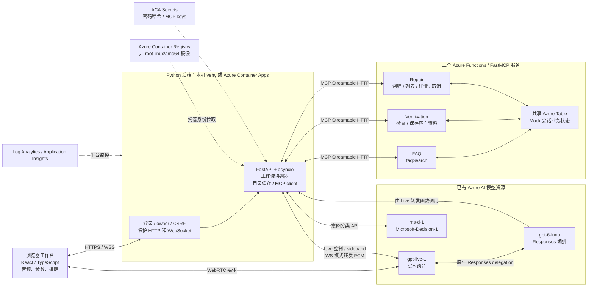
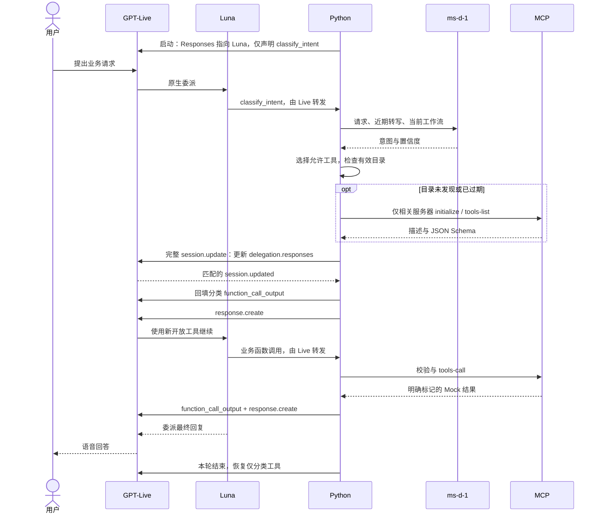

# GPT-Live Intent-Driven MCP

[English](README.md) | [简体中文](README.zh-CN.md)

**使用 Python 串联 GPT-Live 原生 Responses 委派、Microsoft-Decision-1 意图识别和 Azure MCP，按意图动态开放工具的实时语音工作台。**

用户与 GPT-Live 交谈，Luna 编排业务请求，Decision-1 判断意图，Python 只开放当前请求所需的工具，并将真实执行结果回填。前端展示分类、目录发现、工具更新、MCP 执行和语音交互中的每一段等待。

> **演示边界：** 模型推理、MCP 协议、登录鉴权和 Azure 基础设施都是真实的；FAQ 内容、客户资料和报修订单明确为 **Mock**。不联系真实售后、不发送报修邮件、不进行 OTP/手机号所有权认证，也不控制设备。模型调用、托管资源和网络均可能产生费用。

## 优势与亮点

| 亮点 | 实现与价值 |
| --- | --- |
| 原生 Responses 委派 | 通过 GPT-Live 会话配置委派 `gpt-6-luna`；不使用另一套独立聊天或 Client delegation 冒充原生流程。 |
| 按意图开放工具 | Luna 启动只看到 **一个** `classify_intent`；Python 调用 `ms-d-1` 后，根据允许范围开放业务函数。 |
| 带确认的工具热更新 | 完整发送 `session.update` 替换 `delegation.responses.tools`，确认后才回填分类结果并续接。 |
| 启动不依赖全量 MCP | 启动业务目录发现请求数为 **0**；只在用户实际提出相关业务时发现所需服务。 |
| 按需、缓存、并行 | 每服务器目录默认缓存 300 秒，同服务器并发刷新合并，不同服务器并行发现；过期失败不静默使用旧目录。 |
| 可观测语音链路 | 当前工具、意图/置信度、排队、父子调用、启动分段和 MCP 耗时可见；不伪造隐藏推理或“用户已听到”的延迟。 |
| 后端执行门禁 | 意图白名单、Schema、可信 `contactId` 注入、必需客户字段、call-ID 去重与分类版本校验共同约束执行。 |
| Azure 托管与登录保护 | HTTPS/WSS、后端 API/WS 登录鉴权、密码哈希、CSRF、注销/到期、托管身份和 Secret references。 |
| 轻量明确的编排 | 使用 FastAPI、`asyncio` 与官方 MCP SDK，无额外 Agent 框架；核心流程可以直接 review。 |

## 系统架构



WebRTC 媒体由浏览器直接与 Live 协商；WebSocket 模式由 Python 转发无文件头的 24 kHz、单声道 PCM16。MCP 接收 JSON 参数，**不接收音频**。

### 使用的 Azure 组件

| 组件 | 职责 |
| --- | --- |
| 已有 Azure AI / Foundry 资源 | 托管三个模型 deployment；推理使用资源级 origin，不是项目 URL。 |
| `gpt-live-1` | 语音、转写及原生委派入口。 |
| `gpt-6-luna` | 调用分类工具、生成业务参数、多轮收集字段、形成委派回复。 |
| `ms-d-1` | Microsoft-Decision-1 的部署名；输出单个意图、confidence 和类别概率，不是 Responses 生成模型。 |
| Azure Container Apps | 托管 Python API 和 React 静态前端；参考配置为 eastus2、单常驻副本、0.5 vCPU / 1 GiB、HTTPS-only ingress。 |
| Azure Container Registry | 保存非 root、venv、`linux/amd64` 镜像，使用托管身份拉取。 |
| 三个 Azure Function App | 独立托管 FAQ、Verification、Repair MCP；参考运行时 Python 3.13、Flex Consumption、自托管 custom handler。 |
| Azure Storage / Table | 共享 Mock 业务状态及独立 Functions 运行存储；参考拓扑共四个 Storage Account。 |
| VNet / Private Endpoint / 私有 DNS | Functions 连接私有 Blob/Table；参考拓扑关闭 Storage 公网和 shared-key。 |
| 用户分配托管身份 / Azure RBAC | Functions 访问存储；工作台访问模型和镜像，角色限制在对应资源。 |
| ACA Secrets | 注入密码哈希和 Function key；仓库不包含共享密码或令牌。 |
| Application Insights / Log Analytics | 平台日志和监控；前端 span 是独立内存事件流，不等于 Portal 已有完整分布式追踪。 |

当前不依赖独立 Azure AI Search、Speech 资源、APIM、Redis、Cosmos DB 或 Foundry hosted agent。

## 按意图热加载的核心流程



**不是 Luna 自己浏览任意 MCP 目录。** Python 管理服务器配置和意图白名单；Luna 只看到当前声明的函数名称、描述和 Schema。“热加载”更新的是模型可见定义与执行权限，不是把 MCP 服务代码安装进模型。

工具配置是 **Live 会话级**，因此同会话业务委派串行协调，语音/事件接收继续，不同 Live 会话独立。提前产生的未授权动作会被拒绝，不会等到后面拿旧权限盲目重放。

`session.updated` 不保证所有异步后台校验已结束，后续配置错误仍会阻止业务执行。低置信度请求先澄清，不发现业务 MCP。

### 工具目录

| 服务 | 工具 | 用途 |
| --- | --- | --- |
| 本地 Python 分类器 | `classify_intent` | 业务执行前调用 Decision-1。 |
| FAQ MCP | `faqSearch` | 固定演示 FAQ，不需客户资料。 |
| Verification MCP | `checkCustomer`、`setCustomerByPhoneAndName` | 检查/保存用户提供的演示字段，**不是 OTP 或真实身份认证**。 |
| Repair MCP | `createRepair`、`listRepairs`、`getRepairDetail`、`cancelRepair` | 操作会话隔离的 Mock 订单。 |

支持意图：`faq`、`repair_create`、`repair_list`、`repair_detail`、`repair_cancel`、`customer_verification`、`clarify`、`out_of_scope`。每次分类返回 **一个 choice**；概率分布不等于多意图识别，但一个流程可以调用多个 MCP 工具。

当前 Mock 写操作在用户明确请求、字段齐全且校验通过后自动执行，不需要审批卡。自动允许不是操作成功，只有实际 MCP 成功结果才应报告完成。

## 本机运行

前提：**Python 3.13**、**Node.js 22.12+**，以及支持本项目 Live / Responses / Decision API 的模型部署权限。本机 CLI 凭据路径需要 Azure CLI。

所有 Python 都使用项目 venv：

```sh
python3.13 -m venv .venv
.venv/bin/python -m pip install -c requirements.lock -e '.[dev]'
cd frontend
npm ci
npm run build
cd ..

# 不覆盖已有私有配置
test -f .env || cp .env.example .env
chmod 600 .env
```

只修改私有 `.env`：

| 配置 | 含义 |
| --- | --- |
| `AZURE_ENDPOINT` | HTTPS **资源级 origin**，如 `https://YOUR-RESOURCE.services.ai.azure.com`；不能使用 `/api/projects/...`。 |
| `AZURE_SUBSCRIPTION_ID` | 本机 CLI 凭据使用的明确订阅。 |
| 三个 `*_DEPLOYMENT` | 默认 `gpt-live-1`、`gpt-6-luna`、`ms-d-1`，填写实际部署名。 |
| `MCP_*_URL`、`MCP_*_KEY` | 三个 HTTPS Function MCP endpoint 及仅后端持有的 key。 |
| `MCP_CATALOG_TTL_SECONDS` | 目录 TTL，默认 300 秒；不是业务结果缓存。 |
| `AUTH_REQUIRED`、`AUTH_USERNAME`、`AUTH_PASSWORD_HASH` | 登录配置，**没有默认密码**。 |

交互输入密码并生成私有哈希：

```sh
.venv/bin/python scripts/configure_studio_login.py --username admin
.venv/bin/python scripts/dev.py
```

打开 **http://localhost:8000**，不要混用 `localhost` 和 `127.0.0.1` Cookie。

不使用云端 MCP 时，可以显式启动三个本地服务：

```sh
.venv/bin/python scripts/dev.py --local-mcp
```

此模式使用 SQLite 作为离线业务状态，不是 Azure Table 故障回退；模型推理仍需要 Azure。`AUTH_REQUIRED=false` 仅用于明确的回环调试，托管容器必须配置认证。

## 业务场景测试

1. 问 **“产品保修期是多久？”**，演示政策回答为一年。
2. 在 **同一会话** 再问 **“我要创建一个报修单。”**，观察 FAQ 工具切换为客户/报修工具。
3. 按追问逐项提供虚构资料：区号 `86`、电话 `0000000000`、姓名 `测试客户`、故障“洗衣机不能启动”、邮编 `000000`、邮箱 `test@example.test`。可选品牌/型号/序列号/地址补充可跳过。
4. 得到实际成功的 `DEMO-...` 单号后，在同会话继续查询列表、详情或取消。

`customer_not_found` 是正常资料收集分支，不表示 MCP 出错。结束会话会清理本会话 Mock 数据，查询订单前不要结束。失败时查看分类、工具更新和失败 span，不能只凭模型一句“现在无法办理”判断系统原因。

## 前端工作台与核心代码

- WebRTC / WebSocket，麦克风与有界 WAV/文件输入。
- 参数表单 / JSON、设备选择、静音和播放控制。
- 支持的 Live/Responses 参数可见；托管 `tools` / `tool_choice` 不能绕过服务端，当前有效工具单独展示。
- 意图/置信度、阶段、队列、目录状态/手动刷新、启动分段。
- 父子瀑布、工具结果、协议事件、用量和脱敏追踪导出。
- 不自动录音，不持久化浏览器对话；导出移除音频、提示词、转写、工具参数、keys 等私密内容。

| Review 入口 | 代码 |
| --- | --- |
| 原生 Responses 配置 | [web.py](src/gpt_live_python/web.py) |
| 更新确认、授权、回填与续接 | [live.py](src/gpt_live_python/live.py)：`classify`、`apply_tools`、`observe_update`、`execute_tool`、`continue_ready` |
| 意图白名单和业务门禁 | [bridge.py](src/gpt_live_python/bridge.py) |
| Decision API / 结果校验 | [azure.py](src/gpt_live_python/azure.py) |
| MCP 发现、缓存和执行 | [remote.py](src/gpt_live_python/remote.py) |
| 函数批次和去重 | [protocol.py](src/gpt_live_python/protocol.py) |
| 实际 Mock 工具实现 | [business.py](src/gpt_live_python/business.py)、[mcp_server.py](src/gpt_live_python/mcp_server.py) |
| 密码哈希 / Azure 身份 | [login.py](src/gpt_live_python/login.py)、[auth.py](src/gpt_live_python/auth.py) |
| 前端阶段与登录入口 | [frontend/src](frontend/src) |

[mcp/](mcp) 是原始参考模块，依赖缺失的 util，并不是可直接运行的服务；可执行服务使用上面的共享 Python 包。

## Azure 部署

两条部署路径独立，避免发布工作台时顺带重建 MCP：

- **MCP Functions：** [infra/main.bicep](infra/main.bicep)、[scripts/package_functions.py](scripts/package_functions.py)、[scripts/deploy.py](scripts/deploy.py)。
- **登录保护的工作台：** [infra/studio.bicep](infra/studio.bicep)、[Dockerfile](Dockerfile)、[scripts/deploy_studio.py](scripts/deploy_studio.py)。

**在创建自己的环境前，必须检查并替换部署脚本/Bicep 中参考环境的订阅、registry、已有模型资源和资源组名称。** 当前不是零配置通用模板。PAT、密码、私有 `.env`、生成参数、部署状态和运行日志不进入 Git。

```sh
# 构建和预览，使用私有配置
.venv/bin/python scripts/deploy_studio.py --build
.venv/bin/python scripts/deploy_studio.py --validate

# 验证 what-if / 权限并确认 Azure 变更后
.venv/bin/python scripts/deploy_studio.py --foundation
.venv/bin/python scripts/deploy_studio.py --push
.venv/bin/python scripts/deploy_studio.py --deploy --url
```

默认引用已有就绪项目环境；首次创建环境需对验证/基础设施命令加 `--create-environment`。环境管理面 `Succeeded` 不等于底层计算一定可用，必须验证实际修订健康和请求。

镜像为非 root、venv、amd64。用户分配身份使用 `AcrPull` 和模型资源级 `Cognitive Services User`；托管运行不使用开发机 CLI token。密码哈希和 Function key 注入 ACA Secret，Registry token/ARM 私有参数文件暂存后清理，不把 secret 作为 CLI 明文参数。

参考工作台为 **单副本、单 Python worker**，因为登录、Live 连接、事件和目录在进程内，重启需重新登录。未设计共享状态前不要打开多副本。长期公网使用应采用企业身份和访问治理，而不仅是共享演示账号。

Functions 自托管 MCP 使用 custom-handler **preview** 配置和 Flex OneDeploy；保持私有 Storage 网络/RBAC，不通过开放 Storage 公网绕过问题。

## 验证与性能观察

```sh
.venv/bin/python -m pytest -q
.venv/bin/python -m ruff check src tests scripts
.venv/bin/python -m mypy src
.venv/bin/python scripts/smoke_mcp.py --local
cd frontend
npm test
npm run build
npm run test:ui
```

参考验收：**48 后端测试、20 前端单测、7 相关浏览器场景**，以及真实公网登录、Live/Decision/FAQ MCP/语音和 WebRTC 创建/关闭。有一个硬件相关的无头 WebSocket 麦克风/worklet 用例受旧镜像也复现的音频时钟问题影响，未计为通过。合成媒体不能证明真实设备听感。

同一机器的两次 WebRTC 启动样本：

| 区间 | 移除全量目录等待前 | 仅分类启动后 |
| --- | --- | --- |
| 创建 HTTP 请求 | 21.95 / 52.33 秒 | 4.84 / 3.32 秒 |
| 到媒体 connected 总区间 | 25.28 / 53.82 秒 | 6.15 / 4.49 秒 |
| 初始工具数 | 8 | 1 |
| 启动业务目录发现 | 三个服务器 | 0 |

这是少量、网络敏感的观察，**不是 SLA**。缓存只省目录发现，实际业务仍需初始化 MCP client 和 `tools/call`；首次业务可能承担延后的等待。验证过同会话 FAQ→报修切换，不声称完成重叠 native delegation 压力验证或任意大工具目录验证。

付费合成语音验收：

```sh
.venv/bin/python scripts/smoke_live.py /path/to/synthetic-24khz-mono.wav
.venv/bin/python scripts/smoke_studio.py https://YOUR-STUDIO.example /path/to/synthetic-24khz-mono.wav
```

公开服务 smoke 交互输入密码，验证登录、匿名拒绝、分类/MCP、语音、最终关闭与注销。只用虚构资料。Azure Table 无原生 TTL 删除，无人再访问的过期数据需维护清理。

## 延伸资料与来源

- [English README](README.md)
- [详细架构和 Azure 资源关系](docs/rg-gpt-live-python-dev-architecture.md)
- [可编辑 Excalidraw](docs/architecture.excalidraw)，使用 [Microsoft Excalidraw](https://aka.ms/excalidraw) 打开
- [前端契约](frontend/README.md)
- [最小 Decision→MCP Python 示例](scripts/example_intent_mcp.py)
- [基础设施来源与第三方许可证说明](infra/NOTICE.md)
