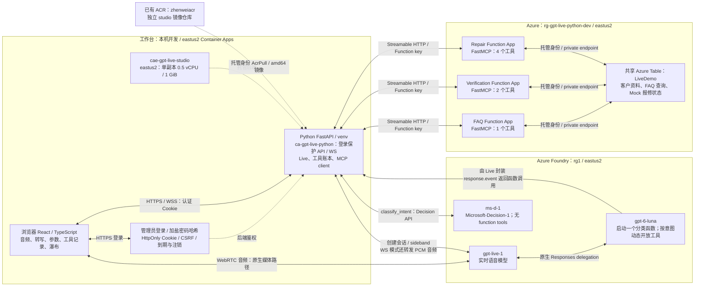
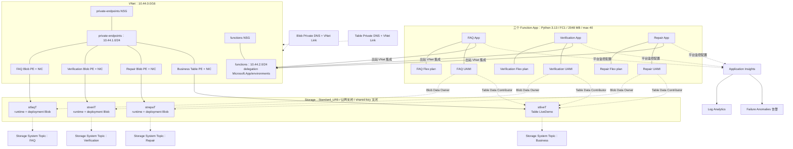
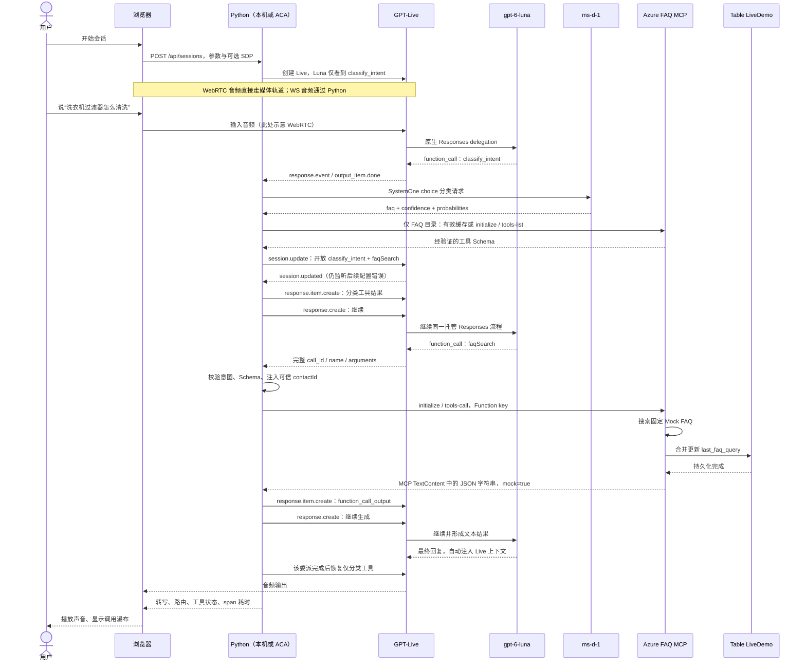
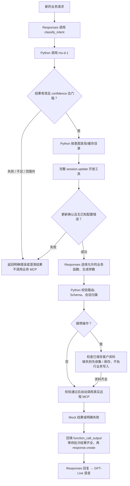
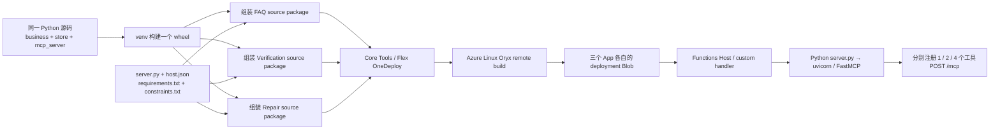

# GPT-Live Python：架构、数据流程与工具部署

核对日期：2026-11-22。当前 Mock 业务自动执行，不需要页面审批；工作台现已增加后端登录并发布到 eastus2 Container Apps。原模型与三个 MCP/私有存储不变。之前的浏览器无声音问题不在本次变更中宣称已修复。

## 1. 一页结论

这是一个“登录保护的语音工作台 + Azure 模型 + 远程 MCP”的应用，支持本机开发与 Container Apps 运行：

```text
浏览器 / React
   ↕ 音频、参数、工具记录、事件
Python / FastAPI（本机开发或 Azure Container Apps）
   ↔ Azure GPT-Live / gpt-live-1
        ↔ 原生 Responses delegation / gpt-6-luna
             → 返回函数调用给 Python
                  ├─ classify_intent → Azure Decision / ms-d-1
                  └─ 七个业务函数 → 三个 Azure Functions MCP
                                       ↔ 私有 Azure Table / Mock 业务状态
```

**准确理解 “LLM 部署了哪些 tools”：**

- Azure 已有三个模型 deployment，本项目复用它们，不训练或修改模型。
- `gpt-live-1` 的职责是实时语音；配置 `delegation.type=responses`，将后台工作交给 `gpt-6-luna`。
- `gpt-6-luna` 启动时只看到 **classify_intent 一个函数定义**。分类成功后，Python 动态开放当前意图的业务工具；模型生成函数名和参数，但不运行 Python。
- `ms-d-1` 是 `Microsoft-Decision-1` 的实际部署名，使用独立 Decision API 返回分类与概率。**它没有配置 function tools，也不是 Responses 生成模型。**
- `classify_intent` 在 Python 后端执行，调用 Decision API；另外 **7 个工具函数在三个远程 MCP 服务执行**。
- 当前不是让 Azure Responses 托管工具直接访问 `type=mcp`，而是 **Responses function call → Python MCP client → 远程 MCP**。
- FAQ、客户资料和报修业务均为 Mock；Azure 模型、HTTP MCP、Table Storage 是真实服务。

## 2. 总体架构图



图中浏览器到 Live 的音频直连只适用于 **WebRTC**。WebSocket 模式的音频经过 Python（本机或 ACA），不走该直连边。

可编辑概览源：[architecture.excalidraw](./architecture.excalidraw)。可在 [Microsoft Excalidraw](https://aka.ms/excalidraw) 打开；其中省略底层资源以便阅读，下节展示完整资源层次。

## 3. 实际用了哪些 Azure 组件

### 3.1 模型资源：已有 rg1

订阅：`a165edb0-c8fb-4569-9e3e-40495d678b10`。Foundry 资源：`zhenw-mlzzscyb-eastus2`，区域 `eastus2`。

| Deployment 名称 | 底层模型 | 版本 | SKU / 当前状态 | 职责 |
| --- | --- | --- | --- | --- |
| `gpt-live-1` | `gpt-live-1` | `2026-09-10` | GlobalStandard / Succeeded | 实时音频输入输出、转写、发起委派 |
| `gpt-6-luna` | `gpt-6-luna` | `2026-09-22` | GlobalStandard / Succeeded | 理解业务请求、生成工具参数、多轮收集资料、形成回复 |
| `ms-d-1` | `Microsoft-Decision-1` | `1` | GlobalStandard / Succeeded | 意图分类、confidence、各类别 probabilities |

资源级 API origin：

```text
https://zhenw-mlzzscyb-eastus2.services.ai.azure.com
```

用户提供的项目 URL 位于 `/api/projects/...`；这是项目上下文地址，不是本代码调用 Live / Decision 时拼接的推理基址。

区域 `eastus2` 是资源位置；这些 deployment 使用 GlobalStandard，不能据此承诺所有推理都在 eastus2 内完成。资源中的其他模型不属于本应用当前链路。

### 3.2 MCP、存储和监控：新资源组

下面的原 MCP 基础设施清单保持不变；新增工作台资源单独列在 3.2.1。

资源组：`rg-gpt-live-python-dev`。下表与当前资源清单对应，共 **35 个可枚举资源**，不含另列的 RBAC、Storage 容器/表、VNet 子网和 DNS 记录。

为压缩资源名，令 `T = ztbtl5p2muqfk`，`S ∈ {faq, repair, verification}`。

| Azure 组件 | 数量 | 实际名称 / 标识 | 作用 |
| --- | ---: | --- | --- |
| Function App | 3 | `func-live-S-T` | 托管三个独立 MCP endpoint；查询均为 Running |
| Flex Consumption plan | 3 | `plan-live-S-T` | FC1 / Linux；每个 App 独立计划 |
| 用户分配托管身份 UAMI | 3 | `id-live-S-T` | 云端服务访问自身 Blob 和共享 Table；不保存 Storage account key |
| Runtime / deployment Storage Account | 3 | `stfaqT`、`strepaT`、`stveriT` | 各 App 的部署包与 Functions host 存储，不是 FAQ 知识库 |
| Business Storage Account | 1 | `stliveT` | Table `LiveDemo`，存放 Mock 会话状态 |
| Virtual Network | 1 | `vnet-live-T` | `10.44.0.0/16`，Functions 访问私有 Storage |
| Private Endpoint | 4 | `pe-faq-blob-T`、`pe-repair-blob-T`、`pe-verification-blob-T`、`pe-business-table-T` | 三个 Blob 和一个 Table 的私有入口 |
| Private Endpoint NIC | 4 | 上述 PE 对应的 `.nic.<GUID>` | PE 的网络接口；不是四台虚拟机 |
| Private DNS Zone | 2 | `privatelink.blob.core.windows.net`、`privatelink.table.core.windows.net` | Storage 域名解析到私有 IP |
| DNS VNet Link | 2 | 上述 DNS Zone 的 `/functions` link | 将两类私有 DNS 关联到工作 VNet |
| Network Security Group | 2 | `vnet-live-T-functions-nsg-eastus2`、`vnet-live-T-private-endpoints-nsg-eastus2` | 实际部署中的两个子网 NSG；属于网络配套，不参与模型工具选择 |
| Application Insights | 1 | `appi-live-T` | Functions 平台侧监控配置 |
| Log Analytics Workspace | 1 | `log-live-T` | Application Insights 关联日志工作区；模板留存 30 天 |
| Smart Detector Alert Rule | 1 | `Failure Anomalies - appi-live-T` | 与 Application Insights 关联的失败异常告警 |
| Event Grid System Topic | 4 | 四个 Storage Account 名 + GUID | 当前清单中存在；source 分别指向四个 Storage Account |

四个 Event Grid System Topic 在当前应用源码中**没有对应订阅者或业务 handler**，也不是 MCP 工具链的中转。仅凭资源存在不推断其具体创建者或安全扫描用途。

三个 Function App 当前参数：

- Python **3.13**，Linux Flex Consumption。
- 每实例内存 **2048 MB**；每 App 最大实例数 **40**。
- `alwaysReady` 当前没有配置常驻实例；首次请求可能出现额外启动等待。
- 三个服务均通过 `functions` 子网做 VNet 出站集成。
- 四个 Storage 都是 **Standard_LRS**、`publicNetworkAccess=Disabled`、`allowSharedKeyAccess=false`。
- 原 MCP 的 Microsoft.App 子网 delegation 不代表工作台部署；工作台现在使用另一个真实的 Container Apps 环境。未新增 API Management、AI Search、Cosmos DB、Redis、Service Bus、独立 Speech 或 Foundry Agent。

### 3.2.1 登录保护的 Container Apps 工作台

地址：[GPT-Live Studio](https://ca-gpt-live-python.lemonpond-66810300.eastus2.azurecontainerapps.io)。

| 组件 | 当前配置 |
| --- | --- |
| Container App | `ca-gpt-live-python`，eastus2，Running / Succeeded |
| Environment | `cae-gpt-live-studio`，项目资源组，Consumption |
| 副本与资源 | single revision，min/max 1，0.5 vCPU / 1 GiB |
| 容器 | 非 root `studio`，`/opt/venv`，linux/amd64 |
| Registry | 复用 RG1 的 `zhenweiacr`，独立 `gpt-live-python/studio` 仓库；不使用管理员密码 |
| Identity | `id-gpt-live-studio`；registry 的 AcrPull、模型资源的 Cognitive Services User |
| 入站 | HTTPS-only 8000 ingress；后端登录保护 API/WS，CSRF、owner 隔离、注销/到期 |
| Secrets | 密码哈希与三个 MCP key 使用 ACA Secret reference；模型不用 API key 或宿主 CLI 登录 |
| 日志 | 环境复用项目 Log Analytics；应用内存 span 仍通过 WSS 显示 |

实际验证包括匿名 API/WS 拒绝、指定账号登录/注销、公共 WSS 的 Decision→FAQ MCP→语音（277 帧及最终用量），以及两个登录后的 WebRTC 连接/最终关闭样本。

部署过程中，新环境曾长时间 Waiting，临时尝试的旧 RG1 环境实际计算资源返回 ManagedClusterSuspended。新项目环境随后就绪，最终应用使用它；仅本任务新建、从未上线的旧 app `ca-gpt-live-studio` 被删除，其他环境/应用不变。此过程不应被误记为模型或 MCP 故障。

### 3.3 云端基础设施关系图



Private Endpoint 是 **Storage 的私有入口**，不是 MCP Function App 的私有入站 endpoint。MCP App 的 HTTPS 地址仍能从本机访问，但需要 Function key。

## 4. 模型看到什么工具，工具真正在哪里执行

### 4.1 可用工具总目录（不是启动时全量暴露）

| 工具 | 自动工作流中 `gpt-6-luna` 可见范围 | 实际执行位置 | 数据 / 副作用 | 执行规则 |
| --- | --- | --- | --- | --- |
| `classify_intent` | 启动及业务阶段 | Python 后端 → Azure `ms-d-1` | 分类请求、近期转写、active workflow；返回意图与概率 | 不需要审批 |
| `faqSearch` | 按意图开放 | FAQ MCP Function App | 读取固定 Mock FAQ；共享 Table 更新 `last_faq_query` | 不需要客户资料 |
| `checkCustomer` | 按意图开放 | Verification MCP Function App | 读取 Table，检查必需客户字段 | 不需要审批 |
| `setCustomerByPhoneAndName` | 按意图开放 | Verification MCP Function App | 保存用户提供的 Mock 资料 | 字段齐全、校验通过后自动执行 |
| `createRepair` | 按意图开放 | Repair MCP Function App | 创建幂等 Mock Draft 报修记录 | 明确请求、客户资料与必需字段齐全后自动执行 |
| `listRepairs` | 按意图开放 | Repair MCP Function App | 列出本会话报修记录 | 需已保存客户资料 |
| `getRepairDetail` | 按意图开放 | Repair MCP Function App | 查询指定报修详情 | 需已保存客户资料 |
| `cancelRepair` | 按意图开放 | Repair MCP Function App | 将 Mock 订单状态改为 Cancelled | 明确请求、客户资料、单号和原因齐全后自动执行 |

客户资料检查仅表示字段已收集并保存，**不是 OTP、手机号所有权或真实客户身份认证**。自动执行不要求额外口头确认或页面点击，但仍需收集必填字段。

三个 MCP endpoint：

| 服务 | 地址 |
| --- | --- |
| FAQ | https://func-live-faq-ztbtl5p2muqfk.azurewebsites.net/mcp |
| Verification | https://func-live-verification-ztbtl5p2muqfk.azurewebsites.net/mcp |
| Repair | https://func-live-repair-ztbtl5p2muqfk.azurewebsites.net/mcp |

### 4.2 JSON Schema 参数

| 工具 | 参数 |
| --- | --- |
| `classify_intent` | `request` |
| `faqSearch` | `query`, `kb_key`, `productCategory: string[]`, `contactId` |
| `checkCustomer` | `contactId` |
| `setCustomerByPhoneAndName` | `contactId`, `bu`, `countryCode`, `phoneNumber`, `customerName` |
| `createRepair` | `contactId`, `addressRemark`, `description`, `zipCode`, `email`, `srType`, `srSubType`；可选 `productModel`, `serialNumber`, `productCategory`, `brand` |
| `listRepairs` | `contactId` |
| `getRepairDetail` | `contactId`, `srNumber` |
| `cancelRepair` | `contactId`, `srNumber`, `cancelReason` |

Python 会覆盖 `contactId` 为当前应用会话 ID；FAQ 的 `kb_key=demo`、资料保存的 `bu=DEMO` 也由服务器注入，不采信模型提供的其他会话标识。

### 4.3 工具如何交给模型

1. 主应用默认仅配置本地 `classify_intent`，启动不连接业务 MCP，也不全量预热目录。
2. Decision 返回意图后，Python 从允许工具推导所需服务器，读取有效缓存或按需 `initialize` / `tools/list`；多服务器依赖并行发现，同服务器并发刷新合并。
3. 将经验证的 MCP `inputSchema` 转为 Responses `parameters`，通过完整 `session.update` 开放分类函数与该意图业务工具，确认后才回填分类结果并续接。

启动配置结构如下：

```json
{
  "model": "gpt-live-1",
  "delegation": {
    "type": "responses",
    "responses": {
      "model": "gpt-6-luna",
      "tools": [
        {
          "type": "function",
          "name": "classify_intent",
          "description": "先执行意图识别，再调用允许的业务工具",
          "parameters": {
            "type": "object",
            "properties": { "request": { "type": "string" } },
            "required": ["request"],
            "additionalProperties": false
          }
        }
      ],
      "tool_choice": "required",
      "parallel_tool_calls": false
    }
  }
}
```

启动时确实只有这一个函数；业务阶段工具集由服务端动态管理。自动工作流的 tools/tool_choice 可以查看但不能被前端手动覆盖，其他 Responses 参数继续保留。它是**会话工具配置更新**，不是把工具代码安装进 LLM。

三个写入函数的 Responses 描述说明：**字段齐全 → Python 校验意图、Schema 与所需客户资料 → 自动调用远程 MCP**。不再创建审批 Future、确认卡或等待用户点击；只有实际 MCP 结果成功才能报告操作完成。

### 4.4 Decision 路由边界

Decision API：

```text
POST <资源 origin>/providers/microsoft/v1/systemone
model = ms-d-1
state = {request, recent_transcript, active_workflow}
questions.intent.type = choice
```

| Decision 结果 | 允许的业务工具 |
| --- | --- |
| `faq` | `faqSearch` |
| `repair_create` | `checkCustomer`, `setCustomerByPhoneAndName`, `createRepair` |
| `repair_list` | `checkCustomer`, `setCustomerByPhoneAndName`, `listRepairs` |
| `repair_detail` | `checkCustomer`, `setCustomerByPhoneAndName`, `getRepairDetail` |
| `repair_cancel` | `checkCustomer`, `setCustomerByPhoneAndName`, `cancelRepair` |
| `customer_verification` | `checkCustomer`, `setCustomerByPhoneAndName` |
| `clarify` / `out_of_scope` | 无 |

默认门槛是 `confidence >= 0.70`，未达到则允许列表为空。`confidence` 与所选类别的 `top_probability` 是不同的服务字段；这个门槛是演示设置，未经生产数据集校准。

**Decision 返回允许的工具范围，不生成所有业务参数，也不直接执行工具。** `gpt-6-luna` 仍负责生成具体参数，Python 最后执行 Schema、白名单和客户资料校验。

## 5. 数据流程图

### 5.1 一次 FAQ 请求的完整时序



Python 没有另起一套独立的 Responses REST 聊天请求；生成过程由 GPT-Live 的原生 Responses delegation 管理。`response.item.create` 提交工具输出后必须再发 `response.create`，不能假定自动续接。

### 5.2 路由与自动执行



当前 Mock 操作不需要审批，不存在 180 秒审批等待或 approvals API。会话关闭、错误意图、非法参数与客户字段缺失仍会阻止相应执行。每个 call_id 保持去重，不能把自动允许执行当成远程写入成功。Function key 仍是受信服务凭据，不能发给浏览器或不可信用户。

tools 更新是 Live 会话级的，所以同一会话的业务委派排队，语音继续。队列拥有者才可更新配置和推进当前工具轮次；尚未分类的排队动作会被拒绝，恢复分类阶段后要求模型重新分类并生成新的工具请求，而不是直接重放旧动作。重新分类撤销旧权限，完成委派后恢复一个分类工具；不同 Live 会话独立处理。

目录默认缓存 300 秒，以服务器和配置为边界，活动任务固定 Schema 快照；过期刷新失败不使用过期目录。前端提供受 CSRF/本机 owner 保护的 `/api/mcp/catalog/refresh` 入口。只缓存工具定义，不缓存业务操作结果。

### 5.3 音频与控制分离

| 模式 | 音频路径 | 控制 / 事件路径 |
| --- | --- | --- |
| WebRTC | 浏览器 ↔ Azure Live，原生 RTP 媒体 | 浏览器 ↔ Python 本机 WS；Python ↔ Live sideband `/sessions/{id}/attach` |
| WebSocket | 浏览器 ↔ Python ↔ Azure Live；Base64、无头 PCM16LE、24 kHz、mono | 与上游 Live WS 一起处理，Python 转发事件给浏览器 |

WebRTC 仍需 Python 提交 SDP 创建会话，不是浏览器携带模型 API key 直连。事件以 Python sideband 为单一处理源，避免同时处理 data channel 导致重复。

**三个 MCP 不处理原始音频。** Decision 接收文本/状态；MCP 接收工具 JSON 参数。Live 音频、Responses 输出和浏览器播放相互独立，最终文本生成完成不能证明扬声器已经播放。

## 6. 工具是怎样部署到 Azure 的

### 6.1 部署链路



- 每个 App 都部署同一个应用 wheel，但 `server.py` 选择 `faq`、`verification` 或 `repair`，只注册自身工具。
- 本地 `mcp/faq_tools.py` 等三个原文件保留参考；实际运行的是当前包中的 [business.py](../src/gpt_live_python/business.py)。
- 这不是“七个 Azure Functions trigger 各执行一个工具”。实际是每个 App 的 HTTP custom handler 入口承接 JSON-RPC，由 FastMCP 分发到相应 Python 函数。
- 不使用 Functions 原生 MCP extension trigger；使用官方 MCP Python SDK 的 **self-hosted / stateless Streamable HTTP** 托管。当前部署沿用 preview custom-handler 配置。
- Python venv 在本机/主应用容器内管理；上传源码和通用 wheel，Azure Linux 远程构建依赖，**不会上传 macOS venv**。

部署包结构：

```text
.build/functions/<service>/
  server.py
  host.json
  requirements.txt
  constraints.txt
  gpt_live_python-0.1.0-py3-none-any.whl
  .funcignore
```

关键 host 配置：

```json
{
  "version": "2.0",
  "configurationProfile": "mcp-custom-handler",
  "customHandler": {
    "description": {
      "defaultExecutablePath": "python",
      "arguments": ["server.py"]
    },
    "http": { "defaultAuthorizationLevel": "function" },
    "port": "8000"
  }
}
```

### 6.2 基础设施与部署命令

代码入口：

- [main.bicep](../infra/main.bicep)：订阅层部署资源组、网络、共享资源和三个服务。
- [service.bicep](../infra/service.bicep)：每个 App 的 FC1、Storage、UAMI、RBAC、Blob private endpoint 和 App settings。
- [network.bicep](../infra/network.bicep)：VNet、子网、私有 DNS。
- [shared.bicep](../infra/shared.bicep)：共享 Table、Table private endpoint、监控。
- [package_functions.py](../scripts/package_functions.py)：构建 wheel 和三个部署包。
- [deploy.py](../scripts/deploy.py)：明确订阅、Bicep validate/what-if/create、Core Tools OneDeploy。

以下是复现命令，**会创建/更新资源，本文整理时没有运行**：

```sh
.venv/bin/python scripts/deploy.py --provision
.venv/bin/python scripts/deploy.py --code
.venv/bin/python scripts/configure_cloud.py
.venv/bin/python scripts/verify_cloud.py
```

原有 `azure.yaml` 保留 azd 支持；本项目实施使用显式订阅的 Azure CLI / Core Tools，避免共享机器上的 azd 默认账户错位。token 经 stdin 交给 Core Tools，不在命令行参数/日志中暴露。三个 App 的 VNet 集成顺序部署，避免共享子网 SAL lease 冲突。

## 7. 数据存在哪里，权限如何控制

### 7.1 Shared Table 的记录形状

```text
Storage Account: stliveztbtl5p2muqfk
Table: LiveDemo
PartitionKey: 应用生成的 contactId / session ID
RowKey: state
expiresAt: 过期时间戳
payload: JSON 字符串
  ├─ bu / countryCode / phoneNumber / customerName
  ├─ last_faq_query
  └─ orders
       └─ DEMO-... → 报修字段 / Draft 或 Cancelled 状态
```

FAQ 固定问答本身位于 Python 代码，不在 Azure AI Search、向量索引或 Blob 文档里；`faqSearch` 当前使用关键词/类别匹配，不是向量检索。返回的 FAQ confidence 是 Mock 条目的固定值，**不是 Decision 模型的 confidence**。

报修号根据会话 ID 和参数确定性生成，同会话相同申请不会重复增加订单。Table 更新使用合并后的 payload 与 ETag 乐观并发控制，避免 FAQ 写入覆盖客户资料。

写入会刷新默认 1800 秒的过期时间。Table 没有原生 TTL 删除：过期读取拒绝并清理，正常浏览器断开时主应用请求 Verification 清理该 session，还可调用有界维护清理。断网/清理失败不能承诺数据已经删除。

Verification 另有 `/maintenance/session`、`/maintenance/expired` 和 `/healthz` HTTP 路由；它们**不是模型 tools**，同样需要 Function key。本机不会直接连接私有 Table。

### 7.2 三类权限，不要混为一谈

| 边界 | 当前机制 |
| --- | --- |
| 浏览器 → Python | 云端 HTTPS 登录、Secure/HttpOnly/SameSite Cookie、Origin/CSRF、session 所有权；显式 loopback 调试可不启用登录 |
| Python → Live / Decision | 本机指定订阅 AzureCliCredential；ACA 明确使用用户分配 ManagedIdentityCredential 与模型资源级 RBAC |
| Python → MCP App | HTTPS + `x-functions-key`，host key 保存在后端私有配置 |
| Function App → Storage | UAMI + Azure RBAC；本 App Blob Data Owner、共享 Table Data Contributor |
| App → Application Insights | 模板配置 UAMI / Metrics Publisher；App Insights 禁用 local auth |
| 模型 → 实际业务操作 | Python 意图白名单、Schema、可信 contactId、客户字段门禁；当前 Mock 校验通过后自动执行 |

MCP 的入站保护不是 Entra 用户 OAuth；UAMI 是 App 访问 Storage 的身份。Storage 私有网络也是独立边界，不能用一把 Function key 替代 Storage RBAC。

当前不是多租户生产客服身份体系。客户姓名、电话、邮箱、地址会作为业务参数进入工具/模型上下文和 Table；调试事件的脱敏不等于这些数据从未被服务处理。

## 8. 前端耗时与 Application Insights

前端瀑布主要来自 Python [trace.py](../src/gpt_live_python/trace.py)：

```text
Python monotonic clock
  → studio.span / studio.route / studio.tools / studio.tool.auto_approved
  → 工作台 WebSocket（云端 WSS）
  → React 瀑布与详情
```

另有 `studio.workflow` 展示阶段、当前有效工具、配置版本、排队和目录状态；`studio.browser_startup` 记录浏览器阶段耗时。后端 startup span 记录凭据、Live 创建与 sideband；浏览器 HTTP 区间包含这些时长，不能重复相加。

关联字段包括 `trace_id`、`span_id`、`parent_id`、`delegation_id`、`response_id`、`call_id`。MCP 请求带 `traceparent`；服务日志记录 handler 完整耗时，响应 `Server-Timing` 的 handler 值是**到响应头开始发送的时间**，不是完整业务耗时。

目前每次工具调用都会新建 MCP client 并 `initialize`，因此可分别看到协商和 tools/call 等待；不是一个已经实现跨工具复用的长连接池。

需要区分：

- Application Insights / Log Analytics 是已经部署并配置的 Functions 平台监控设施。
- 前端 span 是应用自定义内存事件流，不是从 App Insights 查询出来的。
- 当前没有显式配置 OpenTelemetry exporter 将本机 Live/Decision/MCP 全链路 span 自动写入 App Insights。仅发送 `traceparent` 和打印日志，不能承诺 portal 中已有完整分布式 trace。
- 同时运行的子 span 不能相加当总耗时；初次调用慢不能在没有平台证据时精确归因为冷启动。
- “Responses 完成”“收到音频”“浏览器播放”“用户听到”是四个不同观察层次。当前没有准确的 delegation 级“用户已听到”回执。

## 9. 当前边界与后续扩展

- 主应用可本机开发，当前已发布登录保护的 Container Apps；单副本避免进程内状态跨副本丢失。
- 当前共享管理员登录适用于演示，不是企业 Entra SSO；长期公网运行应轮换演示密码、进一步完善访问与审计。
- 登录、Live 会话、路由和事件缓冲在 Python 进程内，重启需重新登录；Table 只保存 Mock 业务状态，不恢复 Live 连接。审批 Future 已移除。
- 没有真实 FAQ / iService / 售后 CRM 接口，没有真实订单创建、邮件、OTP 或设备控制。
- 未使用 Foundry hosted agent、Durable Functions 或 APIM 来编排；`gpt-6-luna + Python` 承担编排。
- 意图不确定、业务失败、网络错误都返回明确错误/澄清，不静默改用 Decision-1.1 或其他模型。
- 之前的真实 smoke 与人工当前体验需区分；本图解释系统结构，不证明当前用户设备上的无声音问题已经排除。

## 10. 从哪里读代码

| 想了解什么 | 主要代码 |
| --- | --- |
| API、默认模型和工具配置 | [web.py](../src/gpt_live_python/web.py) |
| Live 双传输、sideband、事件、工具回填 | [live.py](../src/gpt_live_python/live.py) |
| Decision 路由 / 自动执行校验 | [bridge.py](../src/gpt_live_python/bridge.py) |
| Decision API 请求和响应字段 | [azure.py](../src/gpt_live_python/azure.py) |
| MCP discovery、桥接描述和 HTTP 调用 | [remote.py](../src/gpt_live_python/remote.py) |
| 七个 Mock 工具 | [business.py](../src/gpt_live_python/business.py) |
| FastMCP 工厂和 Functions custom handler | [mcp_server.py](../src/gpt_live_python/mcp_server.py) |
| Azure Table / 本地显式 SQLite | [store.py](../src/gpt_live_python/store.py) |
| 前端连接、录音和播放 | [useStudio.ts](../frontend/src/useStudio.ts)、[engine.ts](../frontend/src/audio/engine.ts) |

### 官方协议参考

- [GPT-Live event API](https://learn.microsoft.com/en-us/azure/foundry/openai/gpt-live-reference)
- [GPT-Live delegation](https://learn.microsoft.com/en-us/azure/foundry/openai/how-to/gpt-live-delegation)
- [Decision API 指南](https://learn.microsoft.com/en-us/azure/foundry/foundry-models/how-to/use-foundry-models-microsoft-decision)（现行文档可能描述 1.1；本项目实际使用 Decision-1）
- [Self-hosted MCP on Azure Functions](https://learn.microsoft.com/en-us/azure/azure-functions/self-hosted-mcp-servers)
- [官方 Python MCP Functions 示例](https://github.com/Azure-Samples/mcp-sdk-functions-hosting-python)
